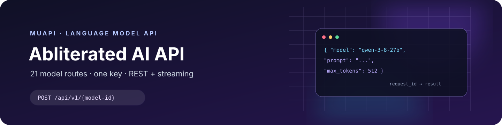

<p align="center">
  
</p>

# Uncensored AI API: Abliterated Models on Muapi

A practical guide to Muapi's abliterated LLM API: 21 model-specific REST endpoints, copyable cURL/Python/JavaScript examples, a model catalog, a dated price snapshot, and clear notes on async polling, streaming, and model limits.

[Get an API key](https://muapi.ai/access-keys) · [Live model catalog](https://muapi.ai/abliterated-llm-api) · [API documentation](https://muapi.ai/docs/api-reference) · [Muapi](https://muapi.ai)

## Related Projects

- [Muapi](https://muapi.ai) — one API platform for generative AI models.
- [Abliterated LLM API catalog](https://muapi.ai/abliterated-llm-api) — live model availability, current rates, and per-model request examples.
- [Muapi API quick start](https://muapi.ai/docs/quick-start) — account setup and API basics.
- [awesome-abliterated-llms](https://github.com/Anil-matcha/awesome-abliterated-llms) — a broader, source-aware index of hosted and open-weight abliterated LLMs.
- [uncensored-coding-models](https://github.com/Anil-matcha/uncensored-coding-models) — coding-agent setup notes and model evaluations.
- [awesome-uncensored-ai-agents](https://github.com/Anil-matcha/awesome-uncensored-ai-agents) — agent integrations, setup patterns, and safeguards.

## Overview

Muapi provides a shared API key and a consistent request lifecycle across a catalog of abliterated, obliterated, and derestricted language models. Each model has its own route, so you select a model by putting its ID in the URL.

The normal request flow is asynchronous:

1. `POST /api/v1/{model-id}` with a prompt and optional supported fields.
2. Read the returned `request_id`.
3. Poll `GET /api/v1/predictions/{request_id}/result` until the job completes.
4. Read the generated text from `outputs`.

For token-by-token output, use that model's `/stream` route. The stream returns server-sent events (SSE) directly instead of a prediction ID.

This repository focuses on API onboarding and integration. For a broader index of hosted and open-weight model variants, see [awesome-abliterated-llms](https://github.com/Anil-matcha/awesome-abliterated-llms).

| Capability | Details |
|---|---|
| Catalog | 21 abliterated, obliterated, and derestricted LLM endpoints across 8 model groups |
| Authentication | Muapi API key in the `x-api-key` header |
| Direct request style | Model-specific REST route; `prompt` is required |
| Async results | Submit, then poll by `request_id` |
| Streaming | `POST /api/v1/{model-id}/stream` returns SSE |
| Compatible chat | Separate OpenAI-compatible `POST /v1/chat/completions` route |
| Image input | Available only on the models marked “Text + image” in the [catalog](docs/MODEL-CATALOG.md) |
| Pricing | Token-metered; see the dated [rate snapshot](docs/MODEL-CATALOG.md) and verify live rates before use |

## Quickstart

Create a key at [muapi.ai/access-keys](https://muapi.ai/access-keys), then set it in your shell:

```bash
export MUAPI_API_KEY="your_muapi_api_key"
```

Submit a prompt to Qwen 3.8 27B Abliterated:

```bash
curl -X POST "https://api.muapi.ai/api/v1/qwen-3-8-27b-abliterated" \
  -H "x-api-key: $MUAPI_API_KEY" \
  -H "Content-Type: application/json" \
  -d '{
    "prompt": "Explain the trade-offs between a monolith and microservices in five concise bullets.",
    "system_prompt": "You are a precise technical writer.",
    "max_tokens": 512
  }'
```

The submit response includes a request ID:

```json
{"request_id":"REQUEST_ID"}
```

Poll for the result:

```bash
curl "https://api.muapi.ai/api/v1/predictions/REQUEST_ID/result" \
  -H "x-api-key: $MUAPI_API_KEY"
```

Continue polling while the status is `pending` or `processing`. When it is `completed`, read the text in `outputs`. A failed job returns `status: "failed"` with an error field. See [`examples/curl/submit-and-poll.sh`](examples/curl/submit-and-poll.sh) for a runnable version.

## Examples

| Language | Example | Requirements |
|---|---|---|
| cURL | [`submit-and-poll.sh`](examples/curl/submit-and-poll.sh) | cURL and `MUAPI_API_KEY` |
| Python | [`quickstart.py`](examples/python/quickstart.py) | Python 3.10+; standard library only |
| JavaScript | [`quickstart.mjs`](examples/node/quickstart.mjs) | Node.js 18+; built-in `fetch` |
| OpenAI Python SDK | [`openai_chat.py`](examples/python/openai_chat.py) | Python 3.10+; `pip install openai` |

The cURL, standard-library Python, and JavaScript examples use the public REST API, keep the key in an environment variable, submit one request, poll its result, and stop on completion, failure, or timeout. The OpenAI SDK example uses the separate compatible chat endpoint.

## Model groups

The current public catalog contains these groups:

| Group | Endpoints | Notes |
|---|---:|---|
| Abliterated Model | 3 | Base, Large, and Large V2 |
| MiMo | 1 | MiMo V2.6 Flash Abliterated |
| Qwen | 6 | Abliterated, obliterated, and derestricted variants |
| Llama | 2 | Llama 3.3 70B and NeuralDaredevil 8B |
| DeepSeek R1 | 2 | Llama 70B and Qwen 32B distill variants |
| GLM | 3 | GLM 5.3 Flash, GLM 5.3, and GLM 4.6 Derestricted V5 |
| Gemma | 3 | Gemma 4 26B and two Gemma 4 31B variants |
| DeepSeek V4 | 1 | DeepSeek V4.1 Flash Abliterated |

The [full model catalog](docs/MODEL-CATALOG.md) lists exact API IDs, image-input support, optional reasoning controls, and published input/output rates. Availability and model details can change; confirm the live catalog before building a dependency on a specific route.

## Request and response flow

The model-specific endpoints use Muapi's own request contract. A typical request is JSON with a required `prompt`; `system_prompt` and `max_tokens` are optional. Add `image_url` or `thinking` only when the selected model supports that field.

```text
POST https://api.muapi.ai/api/v1/{model-id}
GET  https://api.muapi.ai/api/v1/predictions/{request_id}/result
POST https://api.muapi.ai/api/v1/{model-id}/stream
```

The model-specific routes use `prompt` rather than a `messages` array. For OpenAI SDKs and chat clients, Muapi provides a separate OpenAI-compatible `POST /v1/chat/completions` route. Check `GET /v1/models?type=text` for exact model IDs and capability flags; function calling is available only on models that advertise `capabilities.tools: true`. The direct `/stream` route and the compatible chat stream are separate interfaces. See [API and integration notes](docs/API.md) and the [OpenAI-compatible setup](docs/OPENAI-COMPATIBLE.md).

## Pricing

Muapi bills LLM requests by token usage. The catalog below includes a dated snapshot of published input/output rates; live rates and availability can change. Compare rates on the [Muapi model catalog](https://muapi.ai/abliterated-llm-api) before deployment. Prices are not included in this repository's code as constants.

## Use cases

These endpoints can be evaluated for:

- Creative writing and editing workflows.
- Open-ended assistants and character-driven applications.
- Comparing model behavior across families with a fixed prompt set.
- Research into model refusal behavior and instruction following.
- Prototyping text and, for supported models, image-understanding workflows.

A lower refusal rate is not a guarantee that a model will answer every prompt or produce correct results. Validate outputs and add application-level safeguards appropriate to your product.

## Compatibility and limits

- **REST:** Any HTTP client that can send JSON and set an `x-api-key` header can call the endpoints.
- **Streaming:** Use the per-model `/stream` route and consume `text/event-stream` events.
- **OpenAI SDK and chat clients:** Use Muapi's separate `/v1/chat/completions` route with `Authorization: Bearer ...`; the individual model routes remain prompt-based REST endpoints.
- **Anthropic-compatible clients:** Muapi exposes a separate Messages proxy at `/anthropic`; see [client integrations](docs/CLIENT-INTEGRATIONS.md) for Claude Code setup and model discovery.
- **Model fields:** Parameters differ by endpoint. The live schema is authoritative for optional fields, output caps, image support, and reasoning controls.
- **Behavior:** Model output depends on model version, prompt, and serving configuration. Reduced refusals do not imply guaranteed behavior or accuracy.
- **Availability and price:** Both can change. Recheck the live model page before release and keep a fallback model where the application needs one.

## Documentation

- [API reference and field behavior](docs/API.md)
- [OpenAI-compatible chat setup](docs/OPENAI-COMPATIBLE.md)
- [Client and agent integrations](docs/CLIENT-INTEGRATIONS.md)
- [Model catalog and dated price snapshot](docs/MODEL-CATALOG.md)
- [Model selection and comparison method](docs/MODEL-SELECTION.md)
- [Safety, limits, and responsible use](docs/SAFETY.md)
- [FAQ and troubleshooting](docs/FAQ.md)
- [Contributing](CONTRIBUTING.md)
- [Security policy](SECURITY.md)
- [Changelog](CHANGELOG.md)

## Contributing

Corrections to model IDs, schemas, examples, and links are welcome. Before changing a model-specific claim, compare it with the current Muapi catalog and record when a price snapshot was checked. See [`CONTRIBUTING.md`](CONTRIBUTING.md).

## License and notices

The documentation and example code in this repository are available under the MIT License. Muapi, model, and product names belong to their respective owners. This repository is an independent developer guide and is not a guarantee of model performance, availability, or output behavior. Use the service and models in line with applicable laws and terms.
